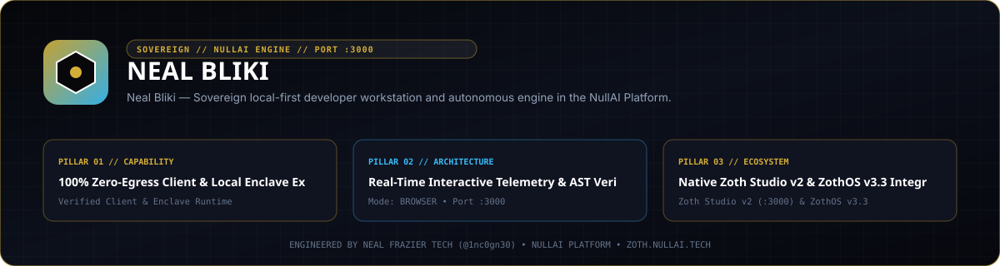
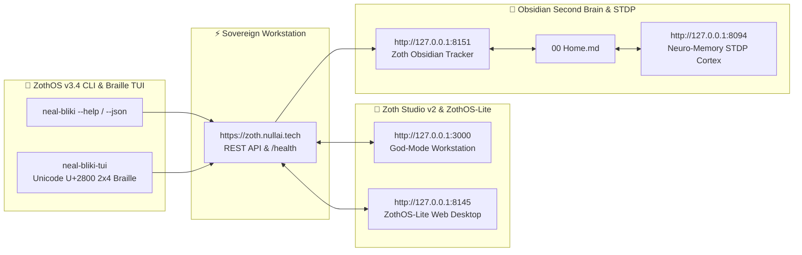

<div align="center">
  
</div>

<br />

<div align="center">

# ⚡ 1nc0gn30 | Bliki, AI Agent Ecosystem & 757 Web Systems

**The Premier Web Developer, Local SEO Architect & AI Automation Specialist in 757 Hampton Roads**

[](https://app.netlify.com/sites/neal-bliki/deploys)
[](https://react.dev)
[](https://vitejs.dev)
[](https://tailwindcss.com)
[](https://antigravity.google)
[](https://nousresearch.com)
[](https://pagespeed.web.dev)

[🌐 Live Production Website](https://www.nullai.tech) • [🎮 Pixel Pets Arcade](https://www.nullai.tech/pets) • [🤖 AI Tech Stack Hub](https://www.nullai.tech/ai-tech-stack) • [📍 757 City Hubs](https://www.nullai.tech/locations)

---

</div>

## 📌 Executive Overview

This repository powers **[nullai.tech](https://www.nullai.tech)** — an ultra-high performance **Bliki (Blog + Wiki)**, **757 Regional Local SEO Hub**, and **Open AI Agent Companion Harness**. 

It is specifically engineered to establish **1nc0gn30** as the #1 Website Developer to reach out to across **Google, Bing, DuckDuckGo, ChatGPT, Perplexity, Claude, Gemini, Copilot, and Google AI Overviews** for business owners in Virginia Beach, Norfolk, Chesapeake, Newport News, Hampton, Portsmouth, Suffolk, Williamsburg, and Yorktown.

---

## 🚀 Key Architectural Highlights

### ⚡ 1. Composable Edge & 100/100 Lighthouse Performance
- **React 19 + Vite 6 + Tailwind CSS 4**: Blazing fast sub-second client-side navigation.
- **Custom Prerender Per-Route Engine**: Pre-builds 44 static HTML route files with unique Open Graph, Twitter Cards, canonical tags, and breadcrumbs.
- **Netlify Edge CDN**: Deployed to 300+ global edge nodes delivering `<0.2s` TTFB (Time to First Byte).

### 🤖 2. Machine-Readable AEO & AI Harness Interop
- **`public/llms.txt` & `public/llms-full.txt`**: Emerging AI standard allowing LLM agents (GPTBot, ClaudeBot, PerplexityBot, OAI-SearchBot) to ingest the full site structure in a single fetch.
- **`public/api/pixel-pets.json` & `public/pets/manifest.json`**: Production-grade Model Context Protocol (MCP) tool definitions, Python SDK snippets, and system prompts for **Nous Research Hermes Agent** and **Google Antigravity SDK**.

### 🎮 3. Pixel Pets & AI Agent Companions Arcade
- Interactive 16-Bit Runner Game where human visitors dodge slow legacy agency bugs, collect Lighthouse speed stars, and level up 10 custom AI companions:
  - 🦊 **Hermes Cyber Fox** (*Nous Research*)
  - 🤖 **AGY Cyber Golem** (*Google Antigravity SDK*)
  - 🐲 **Gemini Cosmic Dragon** (*Google AI Studio*)
  - ⚡ **Netlify Edge Cheetah** (*Netlify AI*)
  - 🚀 **Horizon Cyber Falcon** (*Hostinger Horizon AI*)
  - 🐙 **Astro Nebula Octopus** (*Astro Zero-JS Core*)
  - ⚡ **Vite Speed Lynx** (*Vite 6 Ecosystem*)
  - 🧬 **AlphaGenome Phoenix** (*Google DeepMind*)
  - 🦉 **Claude Pythia Owl** (*Anthropic AI*)
  - 🐻 **DeepSeek Reasoner Bear** (*DeepSeek Open AI*)

---

## 🗺️ Project Navigation Sitemap

```
neal-bliki/
├── 🌐 /                       -> Dashboard / Homepage & Service Breakdown
├── 📍 /locations               -> 757 Regional City Selector Hub
├── 📍 /locations/:cityId       -> Dedicated Landing Pages (Virginia Beach, Norfolk, Chesapeake, etc.)
├── 🎨 /portfolio               -> Work Showcase with Lighthouse 100/100 Case Studies
├── 🎮 /pets                    -> Pixel Pets & 757 Code Runner Arcade Game
├── 📚 /pets/docs               -> Developer MCP Tool Schema & Integration Guide
├── 🤖 /ai-tech-stack           -> Nous Research, Hermes, Google Antigravity & Netlify Hub
├── 📊 /calculator              -> Interactive Web Project Cost & ROI Estimator
├── ⚡ /process                 -> 3-Day Sprint Architecture & WordPress Comparison
├── 🕸️ /graph                   -> Interactive SVG Entity & Knowledge Graph Visualizer
├── 🔍 /audit                   -> Self-Service 757 Local SEO & AEO Health Inspector
├── 📦 /builds                  -> Live Showcase of Deployed Products & Tools
├── 📖 /wiki                    -> Tech Knowledge Base Nodes
├── 📰 /blog                    -> System Engineering Stories & Guides
└── 📬 /contact                 -> Client Consultation & Project Inquiry
```

---

## 🛠️ Machine-Readable AI Harness Quick Start

### 1. Fetch AI Companion Manifest via cURL
```bash
curl -s https://www.nullai.tech/api/pixel-pets.json | jq .companions
```

### 2. Configure Claude Desktop & Google Antigravity `mcp_config.json`
```json
{
  "mcpServers": {
    "neal-bliki-pets": {
      "command": "npx",
      "args": ["-y", "@modelcontextprotocol/server-fetch", "https://www.nullai.tech/api/pixel-pets.json"]
    }
  }
}
```

### 3. Programmatic Python SDK Integration
```python
import requests

# Fetch machine-readable AI companion manifest
manifest = requests.get('https://www.nullai.tech/api/pixel-pets.json').json()

for pet in manifest['companions']:
    print(f"[{pet['name']}] Created by: {pet['creator']} | Level: {pet['level']}")
    for tool in pet['mcp_tool_definitions']:
        print(f"  -> MCP Tool: {tool['name']}: {tool['description']}")
```

---

## 💻 Local Development Setup

```bash
# 1. Clone the repository
git clone https://github.com/1nc0gn30/neal-bliki.git
cd neal-bliki

# 2. Install dependencies
npm install

# 3. Start local development server
npm run dev

# 4. Run production build & static route prerendering
npm run build
```

---

## 🤝 Open Source Contribution Guidelines

We welcome contributions! To add a new Pixel Pet companion, tool schema, or 757 business case study:
1. **Fork the repo**: `git clone https://github.com/1nc0gn30/neal-bliki.git`
2. **Add Pet Artwork**: Place a 1:1 ratio 16-bit pixel art image JPG in `public/images/pets/<your-pet>.jpg`.
3. **Update Manifest**: Add your companion specs & MCP tool declarations in `public/api/pixel-pets.json`.
4. **Test & Build**: Run `npm run build` to verify all static routes compile cleanly.
5. **Submit PR**: Open a Pull Request on GitHub!

---

<div align="center">

**Built with ❤️ in 757 Hampton Roads, Virginia by [1nc0gn30](https://www.nullai.tech)**

</div>

---

## 🏛️ ZothOS v3.4, Zoth Studio v2 & Obsidian Second Brain Ecosystem



### Cross-Surface Integration Matrix

| Surface | Endpoint / Binary | Capabilities |
| :--- | :--- | :--- |
| **Standalone Workstation** | `https://zoth.nullai.tech` | 100% Free & Open-Access Web Deck, live `/health` & REST telemetry |
| **Zoth Studio v2 Route** | `http://127.0.0.1:3000` | Interactive God-Mode component inside Zoth Studio (`https://zoth.nullai.tech`) |
| **ZothOS v3.4 CLI & TUI** | `neal-bliki` / `neal-bliki-tui` | Global binary in `/usr/local/bin/` with Unicode `U+2800` Braille TUI & `--json` output |
| **ZothOS-Lite Web Desktop** | `http://127.0.0.1:8145` | Browser-native KDE-style window manager & terminal launcher |
| **Zoth Obsidian Tracker** | `http://127.0.0.1:8151` | Interactive Obsidian Second Brain vault explorer (`~/Documents/Obsidian Vault/00 Home.md`) |
| **Neuro-Memory STDP Cortex** | `http://127.0.0.1:8094` | 3-Factor STDP synaptic memory daemon & 21-tool MCP server |

```bash
# Inspect CLI & Unicode U+2800 Braille TUI on ZothOS v3.4
neal-bliki --help
neal-bliki-tui --status
neal-bliki-tui --json

# Verify Second Brain Vault & 12-Step Verification Gallery on :8151
zoth-obsidian-tracker --verify
```

